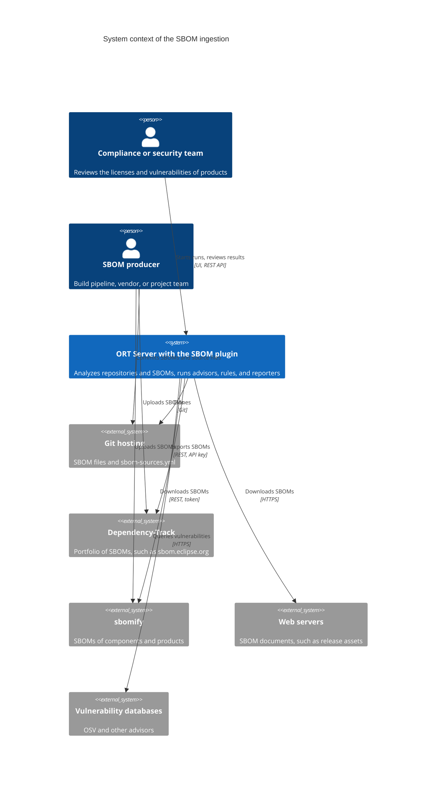
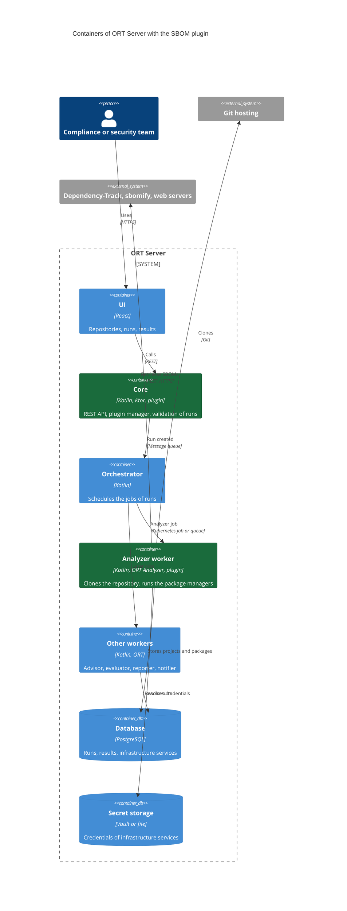
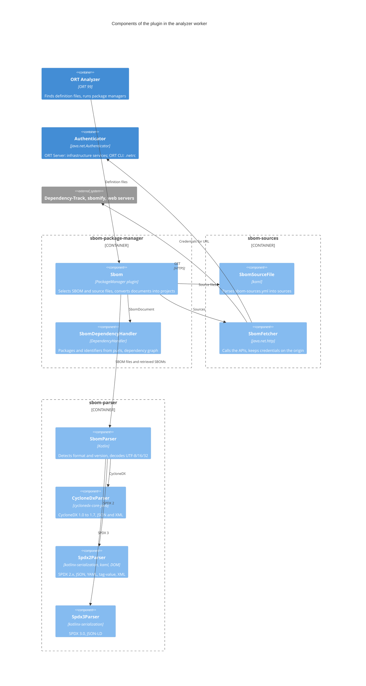
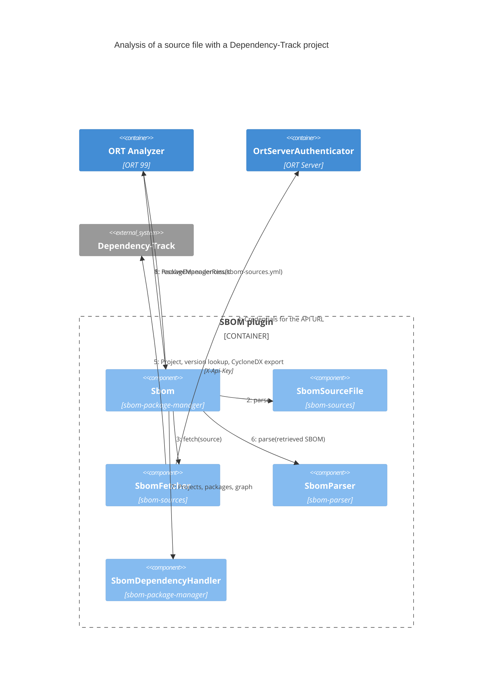

# Architecture

This page describes the architecture of the plugin with the [C4 model](https://c4model.com/), from the systems it
interacts with down to its components, using ORT Server as the host application. The plugin works the same way in any
application that runs the ORT Analyzer, such as the ORT CLI.

## System context

ORT Server analyzes the SBOMs that are committed to Git repositories or listed in [source files](sources.md), and
retrieves the latter from Dependency-Track, sbomify, or any web server. The packages of the SBOMs are then checked like
those of source code, for instance for vulnerabilities.



## Containers

Within ORT Server, two containers include the plugin: the **core**, whose plugin manager lists the installed plugins and
rejects runs that enable unknown package managers, and the **analyzer worker**, which runs the ORT Analyzer with the
`SBOM` package manager. The other containers are unchanged: they work on the projects and packages the analyzer
produced.



## Components

The plugin consists of three libraries. `sbom-package-manager` is the ORT plugin; it uses `sbom-sources` to retrieve
remote SBOMs and `sbom-parser` to read all SBOMs into a format-independent model, which it maps to the ORT model.
Credentials are requested from the default `java.net.Authenticator`, which ORT Server backs with its infrastructure
services, so the plugin does not depend on ORT Server.



## Dynamic view: analyzing a source file

The following steps happen in the analyzer worker for a repository that contains an `sbom-sources.yml` file listing a
Dependency-Track project.



## Deployment

Without changing ORT Server, the plugin is deployed with images derived from the released images of ORT Server. The
[ORT Server images workflow](ort-server.md#published-images) adds the jars of the plugin to the core and analyzer worker
images, checks that they contain the ORT version the plugin was built for, and copies the other images, so that the
Helm chart of ORT Server uses them with a single `containerRegistry` value. In the analyzer pod, only the analysis
container runs the plugin; it receives the credentials of the infrastructure services from the preparation container.

```mermaid
C4Deployment
    title Deployment of ORT Server with the SBOM plugin

    Deployment_Node(github, "GitHub", "heurtematte/ort-sbom-plugin") {
        Container(workflow, "ORT Server images workflow", "GitHub Actions, Docker", "Base image + plugin jars, ORT version check")
        ContainerDb(registry, "ghcr.io/heurtematte/ort-sbom-plugin", "Container registry", "ort-server-core, ort-server-analyzer-worker, copies of the other images")
    }

    Deployment_Node(k8s, "Kubernetes cluster", "Helm chart of ORT Server") {
        Deployment_Node(corePod, "Core pod", "ort-server-core") {
            Container(core, "Core", "JVM", "/app/libs/* + /app/plugins/*")
        }
        Deployment_Node(analyzerPod, "Analyzer job pod", "ort-server-analyzer-worker") {
            Container(prep, "analyzerinit", "Preparation phase", "Clones, resolves credentials")
            Container(main, "analyzer-main", "Analysis phase", "ORT Analyzer with the SBOM plugin")
            Container(result, "analyzerresult", "Result phase", "Stores the results")
        }
    }

    Rel(workflow, registry, "Pushes")
    Rel(corePod, registry, "Pulls")
    Rel(analyzerPod, registry, "Pulls")
    Rel(prep, main, "Repository, auth-info.json", "emptyDir")
    Rel(main, result, "Analyzer result", "emptyDir")

    UpdateLayoutConfig($c4ShapeInRow="3", $c4BoundaryInRow="2")
```

## Design decisions

| Decision | Rationale |
| -------- | --------- |
| An ORT package manager plugin | ORT discovers package managers with the `ServiceLoader`, so the plugin works in ORT and ORT Server without changing them, and all later steps of ORT apply to SBOMs as to source code. |
| Format and version detected from the content | Every supported format identifies itself, so users never have to specify it, and files with unusual names are recognized. |
| A format-independent model | The six serializations of CycloneDX and SPDX are read into one `SbomDocument`, which is mapped to ORT once. |
| Identifiers derived from purls | Packages get the identifiers of ORT's native package managers (`Maven`, `NPM`, ...), so advisors, curations, and rules work on them. |
| The `DependencyGraphBuilder` of ORT | Packages shared by many projects are stored once, which keeps large SBOMs, such as those of Kubernetes, small in the result. |
| Remote sources retrieved at each analysis | The results follow the SBOMs maintained in Dependency-Track or sbomify, while the source file, versioned in Git, records what is analyzed. |
| Credentials from the default authenticator | No dependency on ORT Server: its infrastructure services, or the `.netrc` file of the ORT CLI, provide the credentials. |
| Credentials only for the origin of a source | Redirects to other origins are followed anonymously, and redirects from HTTPS to HTTP are refused, so that API keys cannot leak. |
| Images derived from released images | The plugin can be used before it is part of ORT Server; the build fails if the image uses another ORT version, as plugins must be built for the ORT version of the host. |
