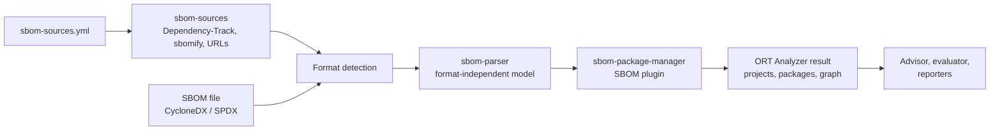

# ORT SBOM Plugin

The ORT SBOM Plugin ingests existing **Software Bills of Materials** into the
[OSS Review Toolkit](https://github.com/oss-review-toolkit/ort) (ORT). Instead of analyzing build files, the ORT
Analyzer reads CycloneDX and SPDX documents and turns them into projects, packages, and a dependency graph, so that the
advisor, the evaluator, and the reporters work on the components they list.

It was written for [ORT Server](https://github.com/eclipse-apoapsis/ort-server), to analyze SBOMs of components whose
source code is not available, such as container images, runtimes, or third-party software
([issue #2937](https://github.com/eclipse-apoapsis/ort-server/issues/2937)), but it works with any ORT Analyzer.

-   :material-file-document-multiple: **All common formats**

    ---

    CycloneDX 1.0 to 1.7 (JSON, XML) and SPDX 2.x (JSON, YAML, tag-value, XML) and 3.0 (JSON-LD), in UTF-8, UTF-16,
    or UTF-32. The format is detected from the content.

    [:octicons-arrow-right-24: Supported formats](formats.md)

-   :material-graph: **Faithful mapping**

    ---

    Described components become projects, the dependency graph and scopes are preserved, and packages are identified
    by their purls, so that vulnerability advisors, curations, and rules apply.

    [:octicons-arrow-right-24: How SBOMs are mapped](mapping.md)

-   :material-cloud-download: **SBOMs from Dependency-Track and sbomify**

    ---

    Source files list SBOMs published in Dependency-Track, sbomify, or at any URL; they are retrieved through the APIs
    at each analysis, with the credentials of ORT Server's infrastructure services.

    [:octicons-arrow-right-24: SBOM sources](sources.md)

-   :material-server: **Ready for ORT Server**

    ---

    Images of ORT Server with the plugin, for Helm and Docker Compose, without changing ORT Server.

    [:octicons-arrow-right-24: Use with ORT Server](ort-server.md)

-   :material-puzzle: **A standard ORT plugin**

    ---

    A package manager plugin with the ID `SBOM`, configurable like the native package managers of ORT.

    [:octicons-arrow-right-24: Getting started](getting-started.md)

-   :material-test-tube: **Tested on real SBOMs**

    ---

    Hundreds of public SBOMs, from the CycloneDX and SPDX specifications to Kubernetes, sbomify, and Eclipse projects,
    are parsed and analyzed in the tests.

    [:octicons-arrow-right-24: Development and tests](development.md)

## How it works

The project consists of three libraries:

| Module                 | Artifact                                         | Content                                                        |
| ---------------------- | ------------------------------------------------ | -------------------------------------------------------------- |
| `sbom-parser`          | `org.eclipse.apoapsis.sbom:sbom-parser`          | Format detection and parsers into a format-independent model  |
| `sbom-sources`         | `org.eclipse.apoapsis.sbom:sbom-sources`         | Source files and retrieval from Dependency-Track, sbomify, URLs |
| `sbom-package-manager` | `org.eclipse.apoapsis.sbom:sbom-package-manager` | The `SBOM` package manager plugin for the ORT Analyzer         |

## License

The project is made available under the [Eclipse Public License 2.0](https://www.eclipse.org/legal/epl-2.0).
