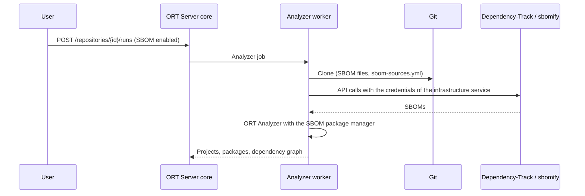

# Use with ORT Server

The plugin was written for the SBOM ingestion in ORT Server
([issue #2937](https://github.com/eclipse-apoapsis/ort-server/issues/2937)). There are three levels of integration:

|                                                        | Images with the plugin | Plugin as a dependency | SBOM repositories |
| ------------------------------------------------------ | :--------------------: | :--------------------: | :---------------: |
| Changes to ORT Server                                  | none                   | build files only       | new feature       |
| SBOM files in Git repositories                         | yes                    | yes                    | yes               |
| SBOMs from Dependency-Track, sbomify, or URLs ([source files](sources.md)) | yes | yes                 | yes               |
| Repositories that are a Dependency-Track project or a sbomify component, without Git | no | no       | yes               |
| Upload of SBOMs with the ORT Server API                | no                     | no                     | yes               |
| Status                                                 | available              | proposed               | proposed          |

## Images with the plugin

ORT Server finds plugins on its classpath, so the plugin can be added to the released images of ORT Server without
changing or rebuilding ORT Server. Two images need it:

- **core**, which rejects runs that enable a package manager it does not know, and lists the installed plugins in the
  UI and the API;
- **analyzer worker**, which runs the ORT Analyzer.

The images of ORT Server start Java with the classpath listed in `/app/jib-classpath-file`.
[`ort-server/Dockerfile`](https://github.com/heurtematte/ort-sbom-plugin/blob/main/ort-server/Dockerfile) builds an
image on top of a released image: it adds the jars of the plugin to `/app/plugins` and appends `/app/plugins/*` to that
classpath. The build fails if the image does not contain the version of ORT the plugin is built against (ORT 98 for
ORT Server 0.99), since plugins must be built for the ORT version of ORT Server. All other libraries the plugin needs
are already part of the images.

### Published images

The [ORT Server images workflow](https://github.com/heurtematte/ort-sbom-plugin/actions/workflows/ort-server-images.yml)
publishes, for a release of ORT Server:

- `ghcr.io/heurtematte/ort-sbom-plugin/ort-server-core:<version>` and
  `ghcr.io/heurtematte/ort-sbom-plugin/ort-server-analyzer-worker:<version>`, with the plugin;
- copies of all other images of that release under the same names, such as
  `ghcr.io/heurtematte/ort-sbom-plugin/ort-server-ui`.

The images are published under the name of the repository, so that they do not collide with other images of ORT
Server of the same owner, such as those built by a fork of ORT Server.

By default, it uses ORT Server 0.99.1; run it manually to build the images for another release.

### Helm

The [Helm chart of ORT Server](https://github.com/eclipse-apoapsis/helm-charts) pulls all images from the same
registry, with the `appVersion` of the chart as tag (0.99.1 for chart 0.26.2). Point it to the published images:

```yaml
containerRegistry: ghcr.io/heurtematte/ort-sbom-plugin

# Only if the packages are private: a secret of type kubernetes.io/dockerconfigjson with access to ghcr.io.
imagePullSecret: ghcr-pull-secret
```

The analyzer worker pods are created by the orchestrator with the same registry, so no other setting is needed. This
also works with the [analyzer phases](https://eclipse-apoapsis.github.io/ort-server/docs/admin-guide/guides/secure-analyzer-setup/)
enabled by default in the chart: the analysis container starts Java with the same classpath file, and receives the
credentials of the infrastructure services of the repository. The values are also available in
[`ort-server/helm-values.yaml`](https://github.com/heurtematte/ort-sbom-plugin/blob/main/ort-server/helm-values.yaml).

### Docker Compose

In a checkout of ORT Server, start the Docker Compose setup with
[`ort-server/compose.yml`](https://github.com/heurtematte/ort-sbom-plugin/blob/main/ort-server/compose.yml), which
replaces the images of core and analyzer worker:

```shell
export ORT_SERVER_IMAGE_TAG=0.99.1
docker compose -f docker-compose.yml -f <ort-sbom-plugin>/ort-server/compose.yml up
```

### Building the images

To build the images locally, or for another registry:

```shell
# Local images ort-server-sbom/ort-server-core:0.99.1 and ort-server-sbom/ort-server-analyzer-worker:0.99.1.
ort-server/build-images.sh 0.99.1

# Push them to a registry, and copy the other images of the release there for the Helm chart.
PUSH=1 MIRROR=1 ort-server/build-images.sh 0.99.1 registry.example.org/ort-server
```

With Docker Compose, use local images with `ORT_SERVER_SBOM_IMAGE_PREFIX=ort-server-sbom/`.

## Analyzing SBOMs

With the plugin installed, SBOMs are analyzed from Git repositories:

1. Create a Git repository with SBOM files, and with an [SBOM source file](sources.md) for SBOMs published in
   Dependency-Track, sbomify, or elsewhere:

    ```yaml title="sbom-sources.yml"
    sources:
      - url: https://sbom.eclipse.org/projects/00000000-0000-0000-0000-000000000000
        version: latest
      - https://app.sbomify.com/public/product/eP_4dk8ixV/
    ```

2. If a source needs credentials, create an infrastructure service with its URL, such as `https://sbom.eclipse.org`,
   whose password secret contains the Dependency-Track API key or the sbomify access token. Infrastructure services of
   the organization, the product, or the repository can be used.

3. Add the Git repository to a product, and start runs with the `SBOM` package manager enabled, in the UI or with the
   API:

    ```json title="POST /api/v1/repositories/{repositoryId}/runs"
    {
      "revision": "main",
      "jobConfigs": {
        "analyzer": {
          "enabledPackageManagers": ["SBOM"]
        },
        "advisor": {
          "advisors": ["OSV"]
        }
      }
    }
    ```

    The package manager can also be enabled in the `.ort.yml` file of the repository
    (`analyzer.enabledPackageManagers`), or together with other package managers for source code repositories that
    contain SBOMs.

At each run, the analyzer worker retrieves the current SBOMs of the sources, so the results follow the SBOMs published
in Dependency-Track or sbomify. Each SBOM becomes one or more projects, and the advisor, evaluator, reporter, and
notifier work on them as usual.



This setup was tested end to end with ORT Server 0.99.1 in Docker Compose: a Git repository with an SBOM file and a
source file listing two versions of a Dependency-Track project (with the API key from an infrastructure service) and a
public sbomify product.

## Plugin as a dependency

Instead of building images, ORT Server can declare the plugin as a runtime dependency of the analyzer worker and the
plugin manager. This requires no change to the code of ORT Server and gives the same features as the images above for
every deployment. It requires the artifacts of the plugin to be published to Maven Central.

## SBOM repositories

The proposed SBOM ingestion for ORT Server builds on the plugin and adds a repository type `SBOM`: runs of such a
repository do not clone source code, but analyze an SBOM obtained from the first available source:

1. **An uploaded SBOM**, with `PUT /api/v1/repositories/{repositoryId}/sbom` (raw body or `multipart/form-data`).
   Uploads are validated with `sbom-parser`; `GET .../sbom` returns the detected format, version, and components.
2. **A Dependency-Track project**, if the repository URL is a project page such as
   `https://sbom.eclipse.org/projects/<uuid>`. The revision of a run selects the version of the project.
3. **A sbomify component or product**, if the repository URL is a page such as
   `https://app.sbomify.com/component/<id>/`. The revision of a run selects the version of the component's SBOM.
4. **Any other URL** pointing to an SBOM.

Credentials for the remote sources come from the infrastructure service whose URL matches the repository URL, as for
source files.
