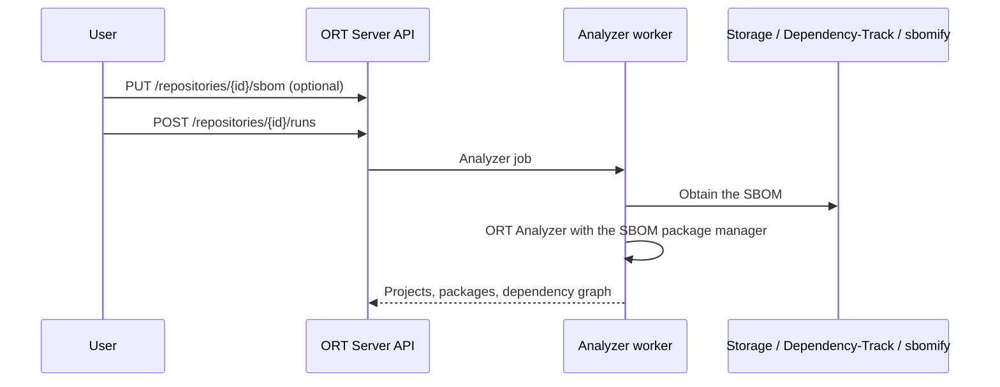

# Use with ORT Server

The plugin is the basis of the SBOM ingestion proposed for ORT Server
([issue #2937](https://github.com/eclipse-apoapsis/ort-server/issues/2937)). The integration adds a repository type
`SBOM`: runs of such a repository do not clone source code, but analyze an SBOM with the `SBOM` package manager, and all
later steps (advisor, evaluator, reporter, notifier) work on the result as usual.

The SBOM of a repository is obtained from the first available source:

1. **An uploaded SBOM**, with `PUT /api/v1/repositories/{repositoryId}/sbom` (raw body or `multipart/form-data`).
   Uploads are validated with `sbom-parser`; `GET .../sbom` returns the detected format, version, and components.
2. **A Dependency-Track project**, if the repository URL is a project page such as
   `https://sbom.eclipse.org/projects/<uuid>`. The revision of a run selects the version of the project.
3. **A sbomify component or product**, if the repository URL is a page such as
   `https://app.sbomify.com/component/<id>/`. The revision of a run selects the version of the component's SBOM.
4. **Any other URL** pointing to an SBOM.

Credentials for the remote sources come from the ORT Server infrastructure service whose URL matches the repository
URL: the password is used as Dependency-Track API key, as sbomify access token, or for basic authentication.

The plugin is also listed in the ORT Server plugin manager, so it can be enabled for source code repositories that
contain SBOM files.

